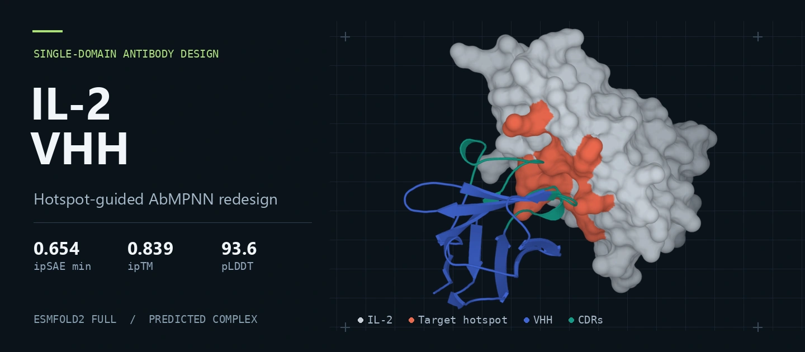

# Hotspot-Guided Antibody Design

**Design VHHs and scFvs around a chosen epitope.** The workflow orients scaffold
CDRs toward the target patch and checks both target and paratope contacts
after co-folding. Active learning prioritizes candidates for evaluation,
followed by final AbMPNN redesign. VHH presets support CDR-only or
full-variable-domain design, with or without hotspots.



**Design case · IL-2 VHH.** The pictured complex is final redesign
`mpnn_55f39b9f4051` from the hotspot benchmark (campaign 009, seed 50).
Predicted confidence: ipSAE min **0.654**, ipTM **0.839**, VHH pLDDT **93.6**.
[Coordinates](examples/il2/mpnn_55f39b9f4051.pdb) ·
[PAE matrix](examples/il2/mpnn_55f39b9f4051_pae.npy)

## Workflow

1. **Place the paratope.** Orient scaffold CDRs toward candidate target
   surfaces or a specified hotspot. AbNumber and ANARCII map IMGT CDRs.
2. **Design and screen.** AbMPNN proposes sequences under the selected
   framework and linker constraints. A surrogate trained on ESMC-6B
   embeddings prioritizes proposals for ESMFold2-Fast screening and
   interface-contact checks.
3. **Redesign and confirm.** Apply a final AbMPNN redesign and rescore the
   shortlist with ESMFold2-Full. The default uses one final seed.

| Mode | No hotspot | With hotspot |
| --- | --- | --- |
| VHH CDR-only | [Config](config/vhh_cdr.yaml) | [Config](config/vhh_cdr_hotspot.yaml) |
| VHH full variable domain | [Config](config/vhh_full.yaml) | [Config](config/vhh_full_hotspot.yaml) |
| VH–VL scFv | [Config](config/vh_vl_full.yaml) | [Config](config/vh_vl_full_hotspot.yaml) |

## Benchmark

The archived August 2026 VHH CDR-only benchmark used 20 attempts per target
and condition, up to five active-learning iterations, and one Full-model
confirmation seed. Counts are unique sequences within each condition that
passed the benchmark filters. The paired VH–VL mode was outside this matrix.

| Target | No hotspot | With hotspot |
| --- | ---: | ---: |
| EGFR domain III | 12 | 0 |
| PD-L1 | 18 | 0 |
| IL-2 | 10 | 4 |

The 120 attempts yielded 44 qualified candidates in 5.33 hours of accounted
runtime on one GPU. Twelve EGFR hotspot attempts encountered scaffold-placement
errors. PD-L1 hotspot predictions failed the configured contact gate.

## Quick start

Run from the repository root with Python 3.12, Git, and a CUDA-enabled
PyTorch environment. The benchmark used one NVIDIA RTX PRO 6000.
Allow about 27 GB on disk for the external model checkpoints.

```bash
python3.12 -m venv .venv
source .venv/bin/activate
python -m pip install --upgrade pip
python -m pip install -r requirements.txt

hf download biohub/ESMFold2 --revision 8fc3ff471022fdce52c77030685eb775de0c00a3 \
  --include 'config.json' 'model.safetensors' 'ccd.pkl' --local-dir models/full
hf download biohub/ESMFold2-Fast --revision c6c7958d63f5f2f1f0fed0bb9462316f8ccceea6 \
  --include 'config.json' 'model.safetensors' --local-dir models/fast
hf download biohub/ESMC-6B --revision 45b0fa5d7fb06faefbd5e3b89bdcef35d564e79a \
  --include '*.json' '*.safetensors' --local-dir models/esmc-6b

python campaign.py --config config/vhh_cdr.yaml --trajectories 20 --min-candidates 3 \
  models.esmfold2.model_path=models/full \
  models.esmfold2.fast_model_path=models/fast \
  models.esmfold2.ccd_cache=models/full \
  models.esmfold2.esmc_path=models/esmc-6b \
  models.esm_engine.model_path=models/esmc-6b
```

The example config uses EGFR domain III. For a custom target, set
`paths.target_fasta` and `paths.target_cif_path` to a matching single-record
FASTA and target-only PDB or mmCIF with chain A. Hotspot positions are
one-based target sequence indices. Set `hotspot.binding_region` in a hotspot
config to a quoted list of positions and ranges, such as `'19,42-44,47'`.

Use `run.py` for one trajectory. Use `campaign.py --resume` to continue an
existing campaign with the same input and model settings. See
[Third-party notices](THIRD_PARTY.md) for the bundled runtime.

## Outputs and scoring

- `runs/campaign_###/` contains the resolved config, status, elapsed time,
  predictions, and final redesigns in `final_post_processed_candidates.csv`.
- `runs/master_candidates.csv` deduplicates and ranks qualified Full-model
  designs. `runs/campaign_summary.json` reports timing and status counts.

The ranking score is `0.5 × ipSAE_min + 0.3 × ipTM + 0.2 × design_pLDDT`,
with pLDDT on a 0–1 scale. `ipSAE_min` takes the lower directional Dunbrack
d0res score at a 10 Å PAE cutoff. The example is a computational prediction
with no experimental validation.

```bash
python scripts/calculate_ipsae.py examples/il2/mpnn_55f39b9f4051_pae.npy examples/il2/mpnn_55f39b9f4051.pdb
python -m unittest discover -s tests -v
```

## References

- [Biohub ESMFold2 and ESMC](https://github.com/Biohub/esm)
- [Dunbrack Lab ipSAE](https://github.com/DunbrackLab/IPSAE)
- [AbMPNN weights and reference](https://doi.org/10.5281/zenodo.8164693)
- [AbNumber](https://github.com/prihoda/AbNumber) and [ANARCII](https://github.com/oxpig/ANARCII)
- [Companion hotspot-guided miniprotein design release](https://github.com/Bio-bbhe/hotspot-miniprotein-design)
